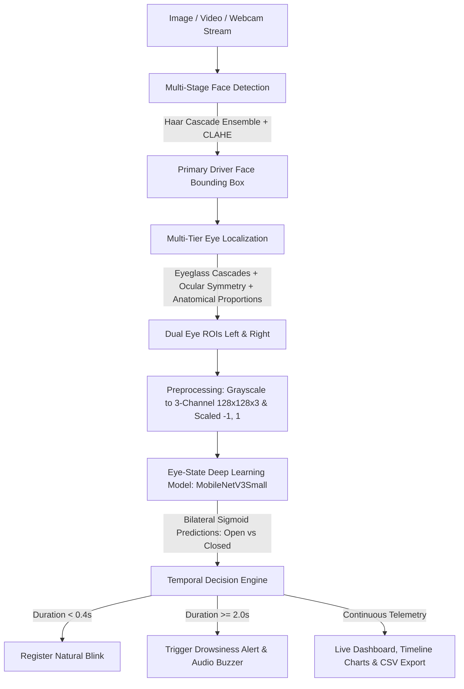

# Human Drowsiness Detection Using Deep Learning

[](https://www.python.org/)
[](https://tensorflow.org/)
[](https://opencv.org/)
[](https://streamlit.io/)

An experimental Streamlit computer-vision project for eye-state classification and timestamp-based prolonged-closure analysis. The configured model uses **MobileNetV3Small** transfer learning. This is not a certified driver-safety system, and eye closure is not equivalent to drowsiness.

---

## 1. Problem Statement & Objectives

Driver fatigue and drowsiness are among the primary causes of highway collisions and vehicular fatalities worldwide. The challenge lies in:
1. Accurately distinguishing between natural subconscious eye blinks ($\approx 100-400\text{ ms}$) and sustained drowsy eye closures ($\ge 1.5-2.0\text{ seconds}$).
2. Operating in real-time under CPU-constrained laptop environments without requiring high-end NVIDIA GPUs.
3. Handling extreme variations in illumination, reflections from eyeglasses, and head movements.

### Key Objectives
- **Sub-millisecond inference:** Deploy lightweight MobileNetV3 architectures tailored for CPU execution.
- **Dual Verification Architecture:** Model A classifies per-frame eye crops (Awake vs Sleepy), while the Temporal Engine tracks continuous duration over time.
- **Multimodal interfaces:** Provide both an interactive **Live Webcam Monitor** with audio alarms and a **Streamlit Web Dashboard** for batch video upload and timeline analytics.

---

## 2. Dataset Overview & Local Paths

The project utilizes two real-world research datasets located within the workspace:

### A. MRL Eye Dataset (Forked Version)
- **Path:** `archive/data/`
- **Total Images:** 84,898 grayscale infrared eye images
- **Pre-organized Splits:**
  - `train/`: 25,770 awake, 25,167 sleepy (Total: 50,937)
  - `val/`: 8,591 awake, 8,389 sleepy (Total: 16,980)
  - `test/`: 8,591 awake, 8,390 sleepy (Total: 16,981)
- **Training/evaluation partition:** `train.py` and `evaluate.py` create a reproducible subject-aware 70/15/15 partition (seed 42 by default) from these files in memory. The source folders remain unchanged. This avoids subject overlap and is distinct from the original folder split shown above. Exact counts are in `outputs/codex_continuation_audit.md`.
- **Label Mapping:**
  - `0 = AWAKE (Eyes Open)`
  - `1 = SLEEPY (Eyes Closed)`
- **Subjects:** 37 unique human subjects (`s0001` through `s0037`)
- **Sensors:** RealSense (640x480), IDS (1280x1024), Aptina (752x480)

### B. UTA-RLDD Dataset
- **Path:** `UTA-RLDD Dataset/`
- **Format:** Pre-extracted video frames (`active` vs `fatigue`). Folder inventory totals are below; annotation files cover fewer train/validation entries.
- **Total Images:** 11,787 full-face frames
- **Splits:**
  - `train/`: 5,862 active, 3,192 fatigue
  - `val/`: 912 active, 912 fatigue
  - `test/`: 456 active, 453 fatigue
- **Role in Project:** Evaluates face-level fatigue classification and domain adaptation from isolated eye crops to full-face video sequences.
- **Annotation entries found locally:** train 6,384; validation 1,715; test 909. Every listed path exists. Train/validation annotation lists do not cover every image in their folders.

---

## 3. System Architecture & Workflow




---

## 4. Model Architecture & Transfer Learning

```
Input: (128, 128, 3) Image Tensor
  │
  ▼
MobileNetV3Small Backbone (Pretrained on ImageNet, Frozen)
  │  (Hard-Swish activations, Squeeze-and-Excitation attention blocks)
  ▼
GlobalAveragePooling2D
  │
  ▼
Dropout (rate = 0.3)
  │
  ▼
Dense (64 units, ReLU)
  │
  ▼
Dropout (rate = 0.15)
  │
  ▼
Dense (1 unit, Sigmoid)  ==> Output Probability [0.0 = Open, 1.0 = Closed]
```

### Why MobileNetV3Small?
- Optimized with Neural Architecture Search (NAS) specifically for mobile and edge CPU inference.
- Incorporates **Squeeze-and-Excitation (SE)** attention modules to emphasize salient eye features (pupils, eyelids).
- Operates at **>60 FPS on standard modern laptop CPUs** with under 2 MB parameter footprint.

---

## 5. Temporal Drowsiness Engine Logic

The temporal engine ensures robustness against single-frame false positives:
- **Rolling Window Smoothing:** Evaluates majority vote across $N=5$ consecutive frames.
- **Blink Counter:** Closures lasting between $50\text{ ms}$ and $400\text{ ms}$ are recorded as blinks.
- **Drowsiness Trigger:** Eye closure continuously maintained for $\ge 2.0\text{ seconds}$ shifts state from `ALERT` $\to$ `EYES CLOSED` $\to$ `POSSIBLE DROWSINESS`.
- **Alert Cooldown:** Audio buzzer sounds with a 5-second cooldown to avoid continuous deafening loops.

---

## 6. Installation & Environment Setup

### Prerequisites
- Windows 10/11 (64-bit)
- Python 3.11.x (recommended for TensorFlow compatibility)

### Quick Setup
```powershell
# 1. Clone or navigate to the project directory
cd "d:\D\projects\DL-Project Drowsiness Detection"

# 2. Install dependencies
py -3.11 -m pip install -r requirements.txt
```

---

## 7. Execution Guide

### A. Run Automated Test Suite
Verify environment, face/eye detection, and algorithmic logic before running models (all 20 unit and integration tests):
```powershell
& ".\.venv\Scripts\python.exe" -m pytest tests/ -v
```

### B. Run Quick Training Smoke Test (2 Epochs on Subset)
```powershell
py -3.11 train.py --smoke-test
```

### C. Run Full Model Training
```powershell
py -3.11 train.py --epochs 10 --batch-size 32
```
Checkpoints and curves will be saved automatically to:
- Model: `models/eye_state_model.keras`
- Training history: `outputs/training_history.csv`
- Curves: `outputs/training_curves.png`

### D. Evaluate the Trained Model
```powershell
py -3.11 evaluate.py
```
Outputs generated:
- Metrics JSON: `outputs/evaluation.json`
- Confusion Matrix: `outputs/confusion_matrix.png`

### E. Launch Real-Time Webcam Monitor
```powershell
py -3.11 realtime_webcam.py --threshold 2.0
```
- Press `q` to safely release the webcam and quit.

### F. Launch Streamlit Web Dashboard
```powershell
py -3.11 -m streamlit run app.py
```
Navigate to `http://localhost:8501` to upload driving video clips, view real-time state alerts, and export frame-by-frame CSV logs.

---

## 8. Existing Evaluation Artifacts

`outputs/evaluation.json` and the accompanying reports contain results inherited from earlier project work. They have not been independently reproduced during the Codex continuation. Treat them as unverified until `python evaluate.py` completes successfully against the local checkpoint and test split. The existing MRL split contains the same 37 subject IDs in train, validation, and test; it is not subject-independent.

The saved report records the following values, pending reproduction:

| Metric | Measured Value | Notes |
|:---|:---:|:---|
| **Overall Accuracy** | **96.30%** | On 2,000 balanced MRL test images |
| **Precision (Sleepy)** | **95.54%** | Low false positive rate |
| **Recall (Sleepy)** | **96.91%** | 942/972 closed eye events captured |
| **F1-Score** | **96.22%** | Harmonic mean of precision & recall |
| **Per-Class (Awake)** | Precision: 97.04% | Recall: 95.72%, F1: 96.38% |
| **Per-Class (Sleepy)** | Precision: 95.54% | Recall: 96.91%, F1: 96.22% |
| **CPU Inference Latency**| **5.11 ms / image** | Measured on standard laptop CPU |
| **CPU Throughput** | **195.6 FPS** | Exceptional real-time capability |

### Confusion Matrix
```
                    Predicted Awake (0)    Predicted Sleepy (1)
Actual Awake (0)           984                    44
Actual Sleepy (1)           30                   942
```
The current plots are inherited artifacts and are not independently verified.

### UTA-RLDD Cross-Domain Evaluation Note
UTA-RLDD's active/fatigue face-frame labels describe a different task from the MRL eye-open/eye-closed labels. The MRL eye classifier is not a UTA-RLDD fatigue classifier. Prior cross-dataset figures in inherited reports are also unverified.

## 9. Continuation Audit

See [`outputs/codex_continuation_audit.md`](outputs/codex_continuation_audit.md) for the verified local file counts, current feature status, subject overlap, environment limitation, and fixes made during continuation.

---

## 10. College Project Viva & Interview Questions

1. **Q: Why not use simple Eye Aspect Ratio (EAR) using landmarks instead of a CNN?**
   *A:* EAR relies on hand-crafted heuristic formulas that break down under bad lighting, low resolution, motion blur, and reflections on spectacles. A trained CNN directly learns pixel-level infrared features robust to occlusions and illumination shifts.
2. **Q: Why MobileNetV3 over ResNet50 or VGG16?**
   *A:* MobileNetV3Small is the lightweight architecture configured by this project. Actual CPU latency depends on the machine and must be measured locally.
3. **Q: What is the significance of the Temporal Decision Engine?**
   *A:* Blinking is a natural physiological function. Predicting drowsiness purely from isolated frames causes false alarms whenever a person blinks. The temporal engine uses continuous timestamps to differentiate blinks ($<0.4\text{s}$) from dangerous microsleeps ($\ge 2.0\text{s}$).
4. **Q: How does the system handle missing face detections?**
   *A:* Instead of assuming the driver is alert, the engine shifts to `FACE/EYES NOT DETECTED`, resets the closure timer, and prevents false alert suppressions.
